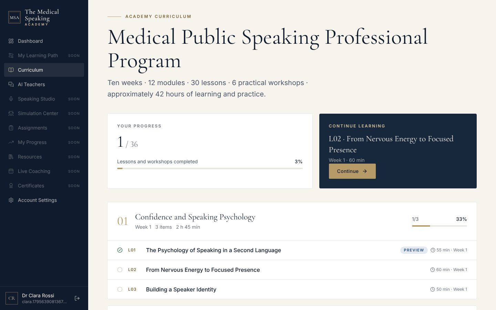
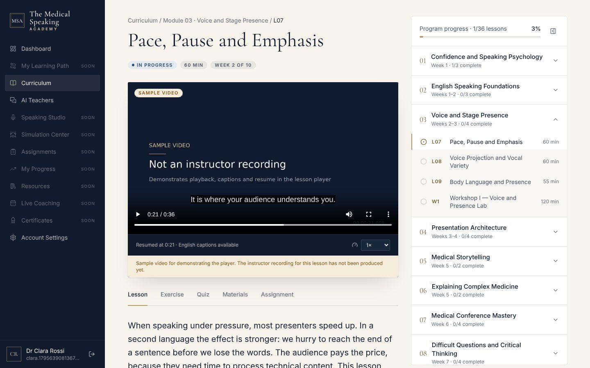
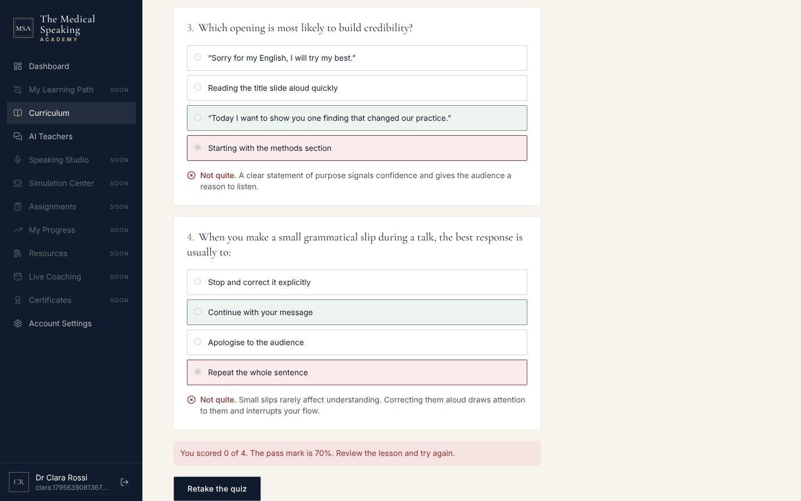
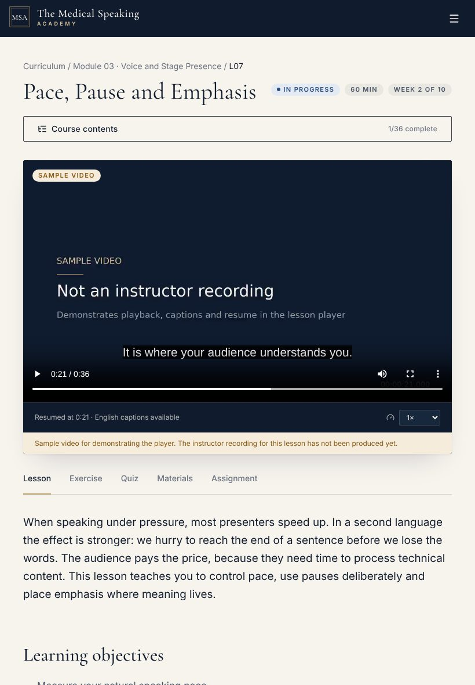
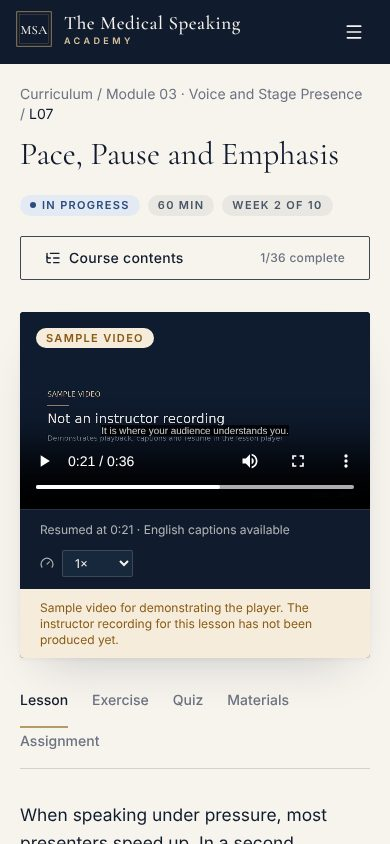
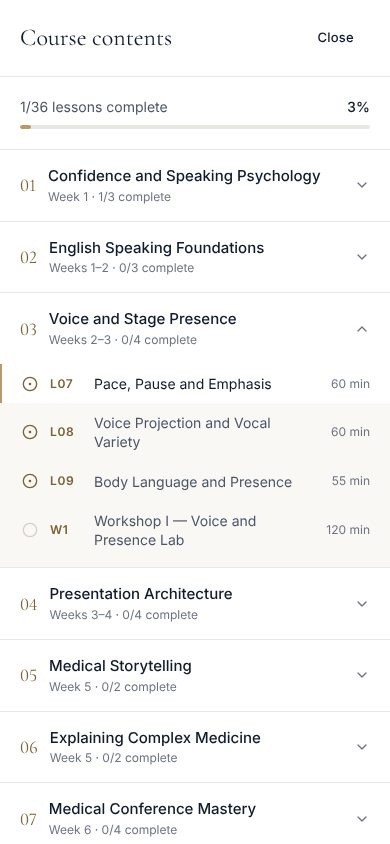

# Stage 3 — Curriculum, Course Player and Learning Experience: Report

Date: 2026-11-25 · Stages 1 and 2 preserved (only additive changes; one CSS rule added for nested lesson sections).

## Summary
The full course structure is in the database: **10 weeks · 12 modules · 30 lessons · 6 workshops · 41.8 hours** (2,510 minutes). Students see the curriculum with durations and their own completion status, study in a premium course player, and their progress, exercises, quiz attempts and assignments are saved to their account and protected by Row Level Security.

## Screenshots
| | |
|---|---|
| Curriculum overview |  |
| Course player (desktop) — sample video, captions, speed, resume, collapsible sidebar |  |
| Knowledge check — server-scored, with explanations |  |
| Tablet |  |
| Mobile player and course-contents drawer |   |

## Requirements
| # | Requirement | Status | Evidence |
|---|---|---|---|
| 1 | Curriculum overview: modules, lessons, durations, completion | **PASS** | `/app/curriculum`; E2E |
| 2 | Premium course player in the approved design | **PASS** | Screenshots; follows approved `/preview/lesson` direction |
| 3 | Large video area, captions, playback controls | **PASS** | Native controls + fullscreen, WebVTT captions on by default, speed 0.75–1.5×, resume from saved position (E2E) |
| 4 | Tabs: Lesson, Exercise, Quiz, Materials, Assignment | **PASS** | E2E |
| 5 | Collapsible curriculum sidebar on the right | **PASS** | Desktop collapse/expand; drawer on tablet/mobile (E2E) |
| 6 | Lesson completion saved per student | **PASS** | `lesson_progress`; completion only via `complete_lesson()` after requirements (E2E + API) |
| 7 | Exercises, quizzes, assignments with persistent progress | **PASS** | Server-side validation (min length/words), server-scored quiz (70% pass, retakes), resubmission until approved |
| 8 | AI Teacher card below the player with conversation entry | **PASS (entry point)** | Card → teacher profile. Live conversations are Stage 4; nothing is simulated |
| 9 | Responsive desktop / tablet / mobile | **PASS** | 1440 / 820 / 390 px, no overflow (E2E) |
| 10 | Admin-ready content architecture | **PASS (database layer)** | Content in DB, editable by content staff without rebuild (API test). Admin UI: Stage 7. See `docs/CONTENT_MANAGEMENT.md` |

## Honest content status
| Item | Status |
|---|---|
| L01, L02, L03 (Module 1) and L07 | **Fully authored**: objectives, explanation, examples, demonstration notes, common mistakes, reflection, exercise, 3–4 quiz questions, assignment. Pending Academic Director approval |
| Other 26 lessons and 6 workshops | **Outline only**, labelled "In preparation": title, summary, duration, week, module outcomes. Cannot be completed until authored |
| Instructor videos | **None recorded.** Lessons show "Instructor recording in production". L07 uses a clearly labelled **sample video** (generated, 36 s) with sample captions to demonstrate the player |
| Downloadable materials | Two **sample** PDF worksheets, labelled "Sample" in the app and on the PDF |
| Enrolment | Granted by staff (SQL) until Stripe in Stage 7. Non-enrolled students get L01 as a preview; other lessons are locked |

## Tests (all from a freshly reset database)
| Suite | Result |
|---|---|
| Stage 3 course E2E (`npm run test:course`) | **36 / 36** |
| Stage 3 course security via API (`npm run test:course-security`) | **26 / 26** |
| Stage 2 RLS — Supabase / plain PostgreSQL | 33 / 33 · 33 / 33 |
| Stage 2 account E2E · API security | 19 / 19 · 23 / 23 |
| Stage 1 public site regression | 0 problems |
| Lint · type-check · build · secret scan | Pass |

Security verified: answer keys never reach students; quiz scored on the server; students cannot write progress directly, forge quiz attempts, self-approve assignments, self-enrol, edit lessons, make a lesson free, read locked content, or see other students' records. Anonymous visitors can read the public syllabus only.

### Defects found by the tests and fixed
1. `lesson_requirements()` failed when items were missing (array append). The server still refused completion, but the UI treated the error as "nothing missing". Fixed in SQL; the UI now **fails closed**.
2. Anonymous syllabus read failed (policy called a staff-only function). Split into separate anonymous / member policies.
3. Video did not resume when metadata loaded before hydration. Fixed.
4. Mobile: long previous/next lesson titles overflowed; tabs truncated. Fixed.

## Requires configuration / next steps
- **Hosted Supabase:** run migrations 2 and 3 in the SQL Editor (`docs/SUPABASE_SETUP.md`).
- **Content:** authoring of the remaining 26 lessons and 6 workshops; Academic Director review of the four authored lessons.
- **Media:** instructor recordings with captions; final branded workbook PDFs (replace `public/*/sample`). Real materials should move to Supabase Storage with signed URLs.
- **Later stages:** AI conversations and Speaking Studio recording (4), instructor review of assignments and live coaching (5), certificates (6), Stripe enrolment and content admin UI (7). "My Learning Path", "My Progress" and "Resources" remain marked "Soon".

## Addendum — content standard v2 (2026-11-25)
- L01, L02, L03 and L07 rewritten to the approved standard (1,253–1,432 words of teaching content, 3 examples, 10–11-phrase banks, 6-question quizzes with 3 scenario questions, model answers, assessment criteria, 15 real references across the four lessons). Review document: `docs/curriculum/lesson-review-L01-L02-L03-L07-v2.pdf`.
- Lesson player renders evidence and recommendation boxes, labelled illustrative examples, phrase bank, mistakes with corrections, references, exercise steps, self-check, model answer (after saving) and assessment criteria. Screenshots: `docs/screenshots/stage-3/v2-*.jpg`.
- Sample worksheets replaced by generated lesson handouts (`public/materials/lessons`).
- British English: "Programme" and "Simulation Centre" throughout.
- Fix: the course-contents sidebar now stays visible while scrolling long lessons.
- Tests: course E2E 41/41, course security 26/26, all Stage 1–2 suites pass.

## Addendum — 26 November 2026
- **L07 corrected** (approved): stress of *cardiomyopathy* and *epidemiology*, verified against Cambridge Dictionary and Oxford Learner's Dictionaries; IPA added. Log: `docs/curriculum/pronunciation-verification.md`.
- **L08 and L09 written** to the approved standard (1,520 and 1,541 words of teaching content) and submitted for review: `docs/curriculum/lesson-review-L08-L09.pdf`. Handouts generated.
- **Workshop navigation implemented:** Briefing · Practice Rounds · Readiness Check · Workshop Pack · Final Task, with workshop wording in the completion panel and placeholders.
- **W1 revised structure:** `docs/curriculum/workshop-W1-structure-v2.pdf` (facilitated and independent versions, intelligibility-based criteria with Beginning/Developing/Competent descriptors).
- Tests: course E2E 43/43 (adds workshop navigation), course security 26/26, Stage 1–2 suites pass.
